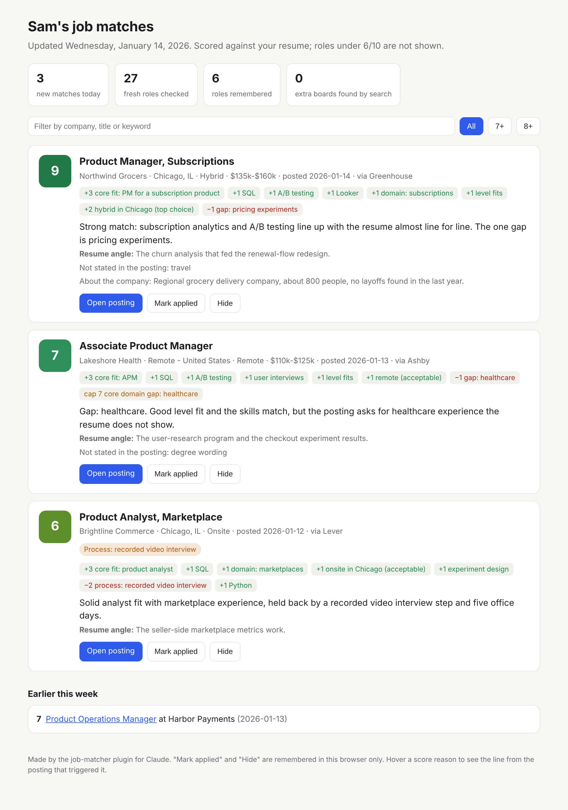

# Job Matcher for Claude

Give Claude your resume once. Every weekday morning it finds fresh openings that fit you, reads each posting all the way through, scores it 1 to 10 against your resume with the evidence behind every point, and puts the results on a dashboard in your Claude account. Roles never repeat, so each morning shows only what's new.



*The sample above uses a made-up resume and made-up companies.*

## What it does

- **Reads your resume** and turns it into a search profile: the titles to look for, your level and years, your skills, and where you can work. You confirm or correct it with a few clicks.
- **Finds fresh roles** posted in the last two weeks on company job boards (Greenhouse, Ashby and Lever, which most tech and mid-size employers use), plus web search to discover companies it wasn't watching yet. If you happen to have Claude's Indeed or ZipRecruiter connectors turned on, it uses those too.
- **Scores every role against your actual resume.** Each point comes with the line from the posting that earned it. It checks the things that usually sink an application: a state you can't be hired in, a years requirement you don't meet, a degree with no "or equivalent experience", a must-have skill your resume doesn't show.
- **Shows you only what's worth your time.** Roles at 6/10 or higher get a card with the score breakdown, your biggest gap, and which part of your resume to lead with. Everything it checked is remembered so you never see it twice.

It never applies, signs in to job sites, or contacts anyone. You decide what to apply to.

## What you need

- A paid Claude plan that includes scheduled tasks (Pro, Max, Ultra, Team or Enterprise).
- That's it. No other accounts, API keys or installs.

## Install

1. In Claude (web or desktop), open **Customize**, then **Plugins**.
2. Choose **Add**, then **Add marketplace**, and enter `connorabuilds/claude-job-matcher`.
3. Install **job-matcher**.

In Claude Code, run:

```
/plugin marketplace add connorabuilds/claude-job-matcher
/plugin install job-matcher@job-matcher
```

Prefer a file? Download `job-matcher.plugin` from the [latest release](https://github.com/connorabuilds/claude-job-matcher/releases/latest) and choose **Add**, then **Upload plugin**.

## Set up (about 3 minutes)

Type `/job-matcher:setup` in a new chat (or just say "set up job matcher"). Claude will:

1. Ask for your resume (PDF, Word or pasted text).
2. Show you what it read and ask a few questions: which roles, where you can work, when to run, anything to avoid.
3. Find the company job boards worth watching for someone like you.
4. Create your **Job matches** dashboard and a weekday scheduled task.
5. Run your first match right away.

After that it runs on its own. Check the dashboard each morning.

## Everyday use

| Say | What happens |
|---|---|
| "Run my job matcher" or `/job-matcher:run` | Runs a match now instead of waiting for the schedule. |
| "Score this job" plus a link or pasted description, or `/job-matcher:score-job` | Scores one posting against your resume with the full breakdown. Works for LinkedIn posts you paste in. |
| "Change my job search" | Change titles, places, the schedule, companies to skip, or upload a new resume. |
| "Pause my job matcher" | Pauses the schedule (you can also do this from the Scheduled page). |

**Tip:** in the scheduled task's settings, turn on automatic approval if your plan offers it, so a 7 AM run never sits waiting for a click.

## Privacy

- Your resume and profile live in two places, both in your own Claude account: your **Job matcher** scheduled task and your **Job matches** dashboard page. Nothing is sent to the plugin's author or any other service.
- Before your resume is saved, your email, phone number, links and street address are stripped out. Scoring doesn't need them.
- The only outside requests are reads of public job boards and web searches.
- The dashboard is private to you unless you share it.

## How it works

See [docs/how-it-works.md](docs/how-it-works.md) for the pipeline, the scoring rubric, and the design decisions behind it (why it reads the bottom of every posting, why scores need quotes, and how it remembers what you've seen without any files on your computer).

## Repository layout

```
.claude-plugin/marketplace.json     marketplace entry, so the repo installs straight from GitHub
plugins/job-matcher/
  .claude-plugin/plugin.json         plugin manifest
  skills/setup/                      resume to profile to schedule
  skills/run/                        the daily match (scoring rubric and sources in references/)
  skills/run/scripts/jm.py           job-board fetching, memory and dashboard (Python, standard library only)
  skills/score-job/                  score one posting on demand
examples/                            fictional profile, scored roles and dashboard
tests/                               python3 -m unittest discover tests
```

## Contributing

Issues and pull requests are welcome. Run the tests before sending a change:

```
python3 -m unittest discover tests
```

## License

MIT. See [LICENSE](LICENSE).
