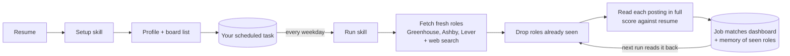

# How it works

Job Matcher is a Claude plugin: three skills (plain-language instructions Claude follows) and one small Python script for the parts that should never vary from run to run. Claude does the reading and judging; the script does the fetching, filtering, remembering and page-building.

## Setup: resume to schedule

1. **Resume to text.** PDF, Word or pasted text becomes plain text, and contact details (email, phone, links, street address) are removed before anything is stored.
2. **Text to profile.** Claude reads the resume into a structured profile: target titles, level, total years and years in the target role, degree, skills, domains, and where the person can work. The years and degree fields are deliberately literal, because they decide the scoring caps later.
3. **Confirm.** A few multiple-choice questions settle what a resume can't say: which roles, which places, remote or not, when to run, what to avoid.
4. **Board list.** Claude names 50 to 70 employers likely to hire this person, adds employers it can see hiring right now through web search, and the script checks which of them have a live Greenhouse, Ashby or Lever board. The 30+ that do become the starting watch list.
5. **Schedule.** The profile, board list and redacted resume are written into the user's own scheduled task. There is no database and nothing on the user's computer: the task prompt is the configuration.

## The daily run

1. **Memory.** The dashboard page carries a hidden JSON block listing every role already scored (company, title, date, score) plus any boards discovered by search. The run reads the page back and restores that memory. Entries expire after 120 days.
2. **Collect.** The script queries every board's public API in parallel and keeps roles that match the profile on three deterministic filters: posted inside the window, a title containing a target phrase and no excluded word (so "Staff" or "Director" drop out for a mid-level person), and a location the person can work from. Remote roles count only when the posting or the job board marks them remote within the person's country. Web search adds a handful of extra postings and, more importantly, new boards that join the watch list from then on.
3. **Dedupe.** Anything already in memory is dropped before any reading or scoring happens, which keeps each run's cost proportional to what's actually new.
4. **Score.** Each remaining posting is read to the end and scored with the rubric below. Large batches are split across parallel subagents, five roles each, so every posting gets a full read rather than a skim.
5. **Publish.** The script merges the results into memory and renders the dashboard; Claude republishes it to the same page. The run's final message, which is also the phone notification, leads with the top match.

## Scoring

The full rubric is in [`skills/run/references/scoring.md`](../plugins/job-matcher/skills/run/references/scoring.md). The design choices that matter most:

- **Knockouts first.** A remote job that "cannot hire in Oregon" is worth zero to someone in Portland no matter how well it fits, and that line is usually near the bottom of the posting under a Location heading. The rubric checks eligibility before anything else, and the excerpt logic in the script makes sure the bottom of the posting is never cut off.
- **No base score.** The score is the sum of the lines that apply. A role starts at zero and earns its points; nothing is "a 5 by default".
- **Every point needs a quote.** Each bonus or penalty carries the phrase from the posting that triggered it, and the dashboard shows it on hover. Generic phrases ("fast-paced", "data-driven") earn nothing.
- **The resume is the source of truth.** A skill counts only if the resume shows it. Each required skill the resume lacks costs a point, and a job whose central domain is missing from the resume is capped at 7 even if the arithmetic says more.
- **Read the heading, not just the number.** "5+ years required" under Requirements caps a two-year candidate at 5. The same line under "Nice to have", or "5 years in product or a related field", does not.
- **When in doubt, lower.** And if a third of a day's roles score 8 or higher, the rubric tells Claude its bonuses are too loose.

## Why these pieces

- **Public ATS APIs over job aggregators.** Greenhouse, Ashby and Lever return the full posting, the real publish date and the employer's own link, with no reposts and no rate limits worth worrying about. Aggregators are optional extras.
- **Deterministic plumbing in code, judgment in Claude.** Date windows, title rules, dedupe and HTML are the same every day, so they live in a tested script. Reading a posting and weighing it against a resume is where a language model earns its keep.
- **State inside the dashboard.** Scheduled runs start fresh each time. Embedding memory in the page they already publish means no extra storage, nothing to sync, and nothing on the user's machine.
- **Never repeat a role.** The dashboard is a daily inbox, not a search page. If it showed the same 30 roles every morning, nobody would read it by Thursday.
